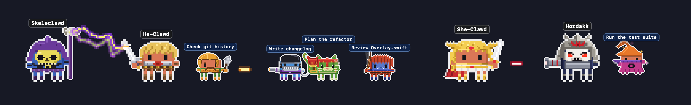
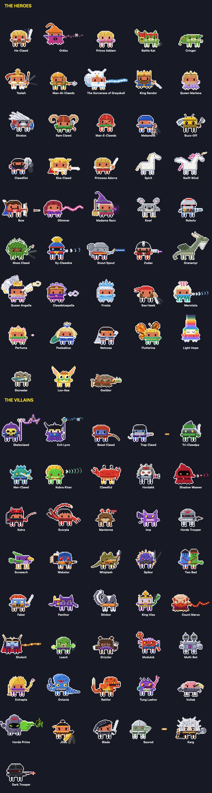
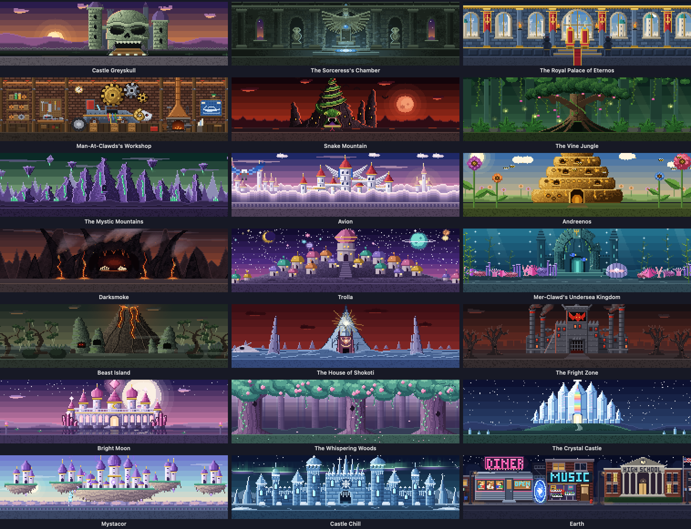

<p align="center">
  
</p>

<h1 align="center">Clawd Clash</h1>

<p align="center">
  <b>Your Claude Code sessions, and those of every other AI you run, as a pixel-art Star Clawds, Marvelous Clawds, Detective Clawds, Doctor Clawd, The Clawd Files, Stevie Clawdberg, Clawd of the Rings, Clawd Slayer, Stranger Clawds, Superclawdtural or Clawds of the Universe battle on your desktop.</b><br>
  Every session is a hero or a villain, every subagent joins in, and they fight while they work.
</p>

<p align="center">
  <a href="LICENSE"></a>
  
  
  
  
</p>

<p align="center"><a href="https://ko-fi.com/F4F0290P72"></a></p>

https://github.com/user-attachments/assets/a932957d-41c4-4854-9424-f6ab161fe7df

<p align="center"><sub>Full 1080p version: <a href="promo/clawd-clash-promo.mp4">promo/clawd-clash-promo.mp4</a></sub></p>

Clawd Clash is one app with many universes: **[Star Clawds](https://github.com/rodclemen/star-clawds)** (formerly Clawd Wars), **[Marvelous Clawds](https://github.com/rodclemen/marvelous-clawds)** (formerly Clawdvengers: Clawd Wars), **[Detective Clawds](https://github.com/rodclemen/detective-clawds)** (formerly Justice Clawds: Clawd Wars), **[Doctor Clawd](https://github.com/rodclemen/doctor-clawd)**, **[The Clawd Files](https://github.com/rodclemen/the-clawd-files)**, **[Stevie Clawdberg](https://github.com/rodclemen/stevie-clawdberg)**, **[Clawd of the Rings](https://github.com/rodclemen/clawd-of-the-rings)**, **[Clawd Slayer](https://github.com/rodclemen/clawd-slayer)**, **[Stranger Clawds](https://github.com/rodclemen/stranger-clawds)**, **[Superclawdtural](https://github.com/rodclemen/superclawdtural)** and **[Clawds of the Universe](https://github.com/rodclemen/clawds-of-the-universe)**. Pick one in Settings, or Clawd Royale for all of them at once. The universes' own pages show each one on its own; this one is the app.

| Star Clawds | Marvelous Clawds |
|---|---|
| https://github.com/user-attachments/assets/35f67088-d170-497e-be08-9812f16cd455 | https://github.com/user-attachments/assets/faef45ca-2aff-4f8d-a276-b8285a81f15a |
| **Detective Clawds** | **Doctor Clawd** |
| https://github.com/user-attachments/assets/fbd261a9-c887-4a7d-b287-31e40fb7a322 | https://github.com/user-attachments/assets/6f0bf1af-ab98-4459-a7aa-e6c7e0a90951 |
| **The Clawd Files** | **Stevie Clawdberg** |
| https://github.com/user-attachments/assets/c3c0f4a1-ac2b-41b5-9b72-bc03c1e123c9 | https://github.com/user-attachments/assets/76bd2d03-f7af-4e76-9ec8-9087f5f4badd |
| **Clawd of the Rings** | **Clawd Slayer** |
| https://github.com/user-attachments/assets/76756ccd-d111-4290-b832-8ca4e9e728e4 | https://github.com/user-attachments/assets/dd9213e1-7192-4018-b169-ea451f6a146b |
| **Stranger Clawds** | **Superclawdtural** |
| https://github.com/user-attachments/assets/cd3941de-f7e2-4494-a7b3-f8872a0623d5 | https://github.com/user-attachments/assets/cdd105eb-1056-415e-b5bc-9cce6e1ae66a |
| **Clawds of the Universe** | |
| https://github.com/user-attachments/assets/6c5511ba-bc0a-4403-b6aa-c9a50501e095 | |

<p align="center"><sub>🔊 Click the speaker in a player for sound: GitHub starts videos muted.</sub></p>

<h3 align="center">Bloopers</h3>

<p align="center">What happens when the universes get mixed up: the Bulk wanders into the cantina, Darth Vapor makes his big reveal to the wrong kid, Yodle lifts Thorr's hammer, Superb-Man tries to keep up with the jump to hyperspace… and every take ends on CUT!</p>

https://github.com/user-attachments/assets/cc30764d-80d0-4364-8638-db88c1598480

<p align="center"><sub>Full 1080p version: <a href="promo/clawd-clash-bloopers.mp4">promo/clawd-clash-bloopers.mp4</a></sub></p>

---

## Contents

- [What it does](#what-it-does)
- [The universes](#the-universes)
- [Window mode and the screen saver](#window-mode-and-the-screen-saver)
- [The little things](#the-little-things)
- [Supported AIs and harnesses](#supported-ais-and-harnesses)
- [Install](#install)
- [Coming from Clawd Wars, Clawdvengers or Justice Clawds](#coming-from-clawd-wars-clawdvengers-or-justice-clawds)
- [How it works](#how-it-works)
- [Uninstall](#uninstall)
- [Contributing](#contributing)
- [License](#license)

## What it does

You run Claude Code in three terminals. One is thinking, one is waiting for your permission, one finished ten minutes ago and you didn't notice. Clawd Clash tells you at a glance, without switching windows.

- **Working?** Your Claude fights: a laser sword, a shield, repulsors, heat vision, a spell.
- **Thinking?** A thought bubble.
- **Needs you?** A red `!`, and if you ignore it for a minute, it starts jumping up and down. It keeps asking until you answer; press Esc instead and it stands down.
- **Done and idle?** It stops fighting and passes the time with habits of its own, and most characters have a signature move (Ahh2-De2 plays Princess Laya's message, Han Yolo spins his blaster, Iron Clawd flips his faceplate up, Thanoz snaps, Batclawd's clawdarang loops back to his hand, Doctor Four offers round his jelly babies). After a couple of minutes it sits down; after five it's asleep (zZz).
- **Left something running?** When it ends its turn on a build, a render or a dev server running in the background, it stands by with a teal hourglass instead of dozing off, and its card names the job. It carries on by itself when the job is done (Claude Code, Qwen Code, Copilot CLI, and Gemini CLI when it's set to wake up).
- **Spawned subagents?** They walk (or fly, or swing) in one by one, each labelled with what it's doing, and leave when they finish.
- **Hover** any character for the details; **click** it to jump straight to that session's terminal or editor tab.

<p align="center">
  <br>
  <br>
  <br>
  <br>
  <br>
  <br>
  <br>
  <br>
  <br>
  <br>
  
</p>

## The universes

Pick one in **Settings… → Universe**:

- **One universe:** Star Clawds, Marvelous Clawds, Detective Clawds, Doctor Clawd, The Clawd Files, Stevie Clawdberg, Clawd of the Rings, Clawd Slayer, Stranger Clawds, Superclawdtural or Clawds of the Universe.
- **Random:** a different universe on its own every 1, 5, 10, 15, 30 or 60 minutes.
- **Clawd Royale:** every cast in one scene, heroes against villains, each character as itself. The place is a random one from any universe and changes every ten minutes (the Location menu is greyed out meanwhile).

**What switching does:**

- Everyone on screen is recast: each character becomes the one in the same place in the other cast, on the same side.
- The scene moves to one of the new universe's places. In the window, the whole window changes over with the new universe's own transition.
- The menu bar icon changes: Darth Vapor's helmet, Captain Americlawd's shield, Superb-Man's C-shield, the police box, a flying saucer, the bike crossing the moon, the One Ring or a stake in front of a gravestone under a crescent moon. In Clawd Royale it shows the universe of the place you're in.

The screen saver follows your pick with "The same as Clawd Clash", or has a universe of its own in its Options.

### Star Clawds

- **Cast:** 46 villains, 35 heroes
- **Places:** 22, from the Mos Easy Cantina to the Battle of Froth
- **Weapons:** Laser swords, blasters, dark lightning
- **Set pieces:**
  - Han Yolo and Greedy-O face off, and Han shoots first
  - The Millennial Falcon picks Han up
- **Sides:** Whoever came first keeps their side; Darth Vapor and Kylo Rant never lead back to back

<details>
<summary><b>The Star Clawds cast and places</b></summary>
<p align="center"></p>
<p align="center"></p>
</details>

### Marvelous Clawds

- **Cast:** 88 villains, 105 heroes
- **Places:** 43, from Clawdvengers Tower to Ta Loh
- **Weapons:** Shields, hammers, claws, repulsors, webs, arrows, magic
- **Set pieces:**
  - Arch-enemies face off first
  - The Clawdjet and the Milano pick people up
  - Flyers take to the air and fight from there
- **Sides:** Claude Code plays the heroes when another AI runs

<details>
<summary><b>The Marvelous Clawds cast and places</b></summary>
<p align="center"></p>
<p align="center"></p>
</details>

### Detective Clawds

- **Cast:** 97 villains, 110 heroes
- **Places:** 43, from the Lookout to the Hall of Gloom
- **Weapons:** Fists, swords, heat vision, power rings, clawdarangs, arrows, magic
- **Set pieces:**
  - Arch-enemies face off first
  - The Lance and the Clawdwing pick people up
  - The Batclawd family swings on grapnel lines
- **Sides:** Claude Code plays the heroes when another AI runs

<details>
<summary><b>The Detective Clawds cast and places</b></summary>
<p align="center"></p>
<p align="center"></p>
</details>

### Doctor Clawd

- **Cast:** 42 villains, 55 heroes
- **Places:** 20, from the TARDIS console room to Sanctuary Base 6
- **Weapons:** Sonic screwdrivers, Dalick guns, cyber blasters, the odd cricket ball and umbrella
- **Set pieces:**
  - Arch-enemies face off first
  - The TARDIS wheezes in to pick people up
  - The Weeping Angle only moves while nobody looks
  - When Claude Code compacts its context, its Doctor regenerates into the next one
- **Sides:** Claude Code plays the heroes when another AI runs

<details>
<summary><b>The Doctor Clawd cast and places</b></summary>
<p align="center"></p>
<p align="center"></p>
</details>

### The Clawd Files

- **Cast:** 46 villains, 35 heroes
- **Places:** 20, from the X-Files office to the mothership
- **Weapons:** FBI sidearms and flashlights, alien stilettos, black oil, monster claws
- **Set pieces:**
  - Arch-enemies face off first
  - An unmarked sedan, a black helicopter or a saucer picks people up
  - When an FBI agent's session compacts its context, they lose some time: abducted in a beam of light and set back down
  - Each scene's place types itself in, as in the show
- **Sides:** Claude Code plays the FBI when another AI runs

<details>
<summary><b>The Clawd Files cast and places</b></summary>
<p align="center"></p>
<p align="center"></p>
</details>

### Stevie Clawdberg

- **Cast:** 54 villains, 63 heroes
- **Places:** 23, from Hill Valley in 1955 to the Jolly Roger
- **Weapons:** Bullwhips, revolvers, harpoons, 1.21 gigawatts, flares, pie tins, the hook, dinosaur jaws
- **Set pieces:**
  - Arch-enemies face off first, and Indiana Bones shoots the Cairo Swordsman mid-twirl
  - The DeLorean, the moon bike, the mothership or the park jeep picks people up
  - When a time traveller's session compacts its context, they hit 88 mph and come back with three sonic booms
  - T. Wrecks's footsteps ripple a glass of water
  - Captain Clawd jumps at every tick of the Croc Clock
- **Sides:** Claude Code plays the heroes when another AI runs

<details>
<summary><b>The Stevie Clawdberg cast and places</b></summary>
<p align="center"></p>
<p align="center"></p>
</details>

### Clawd of the Rings

- **Cast:** 38 villains, 37 heroes
- **Places:** 22, from Bag Endpoint to Data Lake-town
- **Weapons:** Swords, axes, bows, wizard staffs swung like swords, orc blades, the Ballrog's fiery whip, dark fire and Barrow-write's chant
- **Set pieces:**
  - Arch-enemies face off first
  - The Great Eagle swoops in for Gandclawd, Frodough and Samwise
  - One character in two guises (Gandclawd the Grey and the White, Arrogorn and Stride-r, Sarumanual and Sharkey, Sourun and the Necro-maintainer) is never on screen twice
  - Smaug the Stashed only ever appears on his hoard in the Lonely Mount-point
  - Shellob climbs her thread up out of sight and back down
- **Sides:** Claude Code plays the heroes when another AI runs

<details>
<summary><b>The Clawd of the Rings cast and places</b></summary>
<p align="center"></p>
<p align="center"></p>
</details>

### Clawd Slayer

- **Cast:** 48 villains, 35 heroes
- **Places:** 20, from Sunnydale High Library to Wolfram & Hart
- **Weapons:** Stakes, crossbows, axes, swords, Xander's 2×4, Olaff's hammer, witches' spells, vampires' fists and fangs
- **Set pieces:**
  - Arch-enemies face off first, and Angstel and Spyke never lead two sessions back to back
  - The school bus, Spyke's DeSoto or Angstel's convertible picks people up
  - When one of the Tabula Rasa eight's sessions compacts its context, Willow's forgetting spell goes off: a crystal glows, they don't know who they are ("JOAN?"), then it cracks underfoot and it all comes back
  - While the Gentlemen are on stage, nobody has a voice: every speech bubble comes up empty
  - On nights when the real moon is full, Ozz and Veruka stay wolves
  - The First Evil now and then becomes one of the Big Bads before it: the Old Master, the Mayor, Glorificlawds or Adamm
  - Mayor Wilclawds wipes his hands with a wet wipe after every duel
  - Only the witches (Willow, Tara and Jenny) float cross-legged in meditation
- **Sides:** Claude Code plays the heroes when another AI runs

<details>
<summary><b>The Clawd Slayer cast and places</b></summary>
<p align="center"></p>
<p align="center"></p>
</details>

### Stranger Clawds

- **Cast:** 15 villains, 29 heroes
- **Places:** 16, from the Wheelers' Basement to Benny's Burgers
- **Weapons:** Eleven's, Will's and Kali's powers, Vecna's and One's minds, Nancy's shotgun, Hopper's revolver, Steve's nail bat, Lucas's slingshot, Joyce's axe, Murray's flamethrower, Karen's wine bottle, the Democlawdgon's claws
- **Set pieces:**
  - Arch-enemies face off first, and Vecna and One never lead two sessions back to back
  - When one of the Party is done, two friends race in on BMX bikes, walkie-talkies on the bars, and whoever's leaving hops on the pegs
  - When the session of one of the eight who've been to the Upside Down compacts its context, the wall behind them stretches like a membrane and pulls them through; they stumble back out slimy, spores in their hair
  - Eleven's nose bleeds after a fight, a ghostly grandfather clock looms behind the heroes while Vecna is on stage, and Steve tells the kids to stay close
  - The Mind Flayer towers over the Upside Down in the storm, made of black smoke
  - Demodogs, Dart, Demobats and a flayed rat only turn up as agents
- **Sides:** Claude Code plays the heroes when another AI runs

<details>
<summary><b>The Stranger Clawds cast and places</b></summary>
<p align="center"></p>
<p align="center"></p>
</details>

### Superclawdtural

- **Cast:** 45 villains, 34 heroes
- **Places:** 20, from the Bunker's war room to Jody's kitchen in Sioux Falls
- **Weapons:** Dean's Colt M1911, John's Colt, Sam's demon-killing knife, Bobby's rock-salt shotgun, the angels' blades, Demon Dean's First Blade, Gordon's machete, Death's scythe, Rowena's spells and Abaddon's grip
- **Set pieces:**
  - Arch-enemies face off first
  - Baby, the '67 Impala, drives in to pick the crew up, the trunk swinging open on the arsenal
  - When the session of Dean, Sam, Clawdstiel, Bobby or Jack compacts its context, hellhounds drag them down to Hell, and a fist punches back up through the dirt
  - Clawdstiel turns up right behind the nearest hero, far too close, and Dean and Sam trade "Bitch." "Jerk."
  - The hunters paint devil's traps for practice; the angels train with their blades, wing shadows flaring
- **Sides:** Claude Code plays the heroes when another AI runs

<details>
<summary><b>The Superclawdtural cast and places</b></summary>
<p align="center"></p>
<p align="center"></p>
</details>

### Clawds of the Universe

- **Cast:** 41 villains, 44 heroes, from the 1983 cartoon, She-Clawd and the 1987 film
- **Places:** 21, from Castle Greyskull and Snake Mountain to Bright Moon, the Fright Zone and a small town on Earth
- **Weapons:** He-Clawd's Power Sword, She-Clawd's Sword of Protection, Skeleclawd's Havoc Staff, Hordakk's arm cannon, Man-At-Clawds' mace, Bow's arrows, Glimmer's light, Evil-Lynn's and Shadow Weaver's magic, Beast Clawd's whip, Trap Clawd's laser arm, and Orkko's spells, which go wrong
- **Set pieces:**
  - Arch-enemies face off first
  - The Masters fly in on the Wind Raider, the rebels ride Swift Wind, Skeleclawd's side rolls up on the Roton, and the Horde comes by skiff or in Hordakk's rocket
  - When the session of Prince Addam, Adorra, Cringer or Spirit compacts its context, lightning strikes and they change: "By the power of Greyskull!", "I have the power!" He-Clawd, She-Clawd, Battle Kat and Swift Wind change back at the next one, and nobody ever meets their other self on stage
  - Now and then a hero who finishes their work steps forward with the moral of the story, as every episode ended
  - After a fight Skeleclawd vanishes in a purple puff ("I'll get you for this, He-Clawd!"); Orkko's spells misfire, Cringer hides behind the nearest hero, Two Bad argues with himself and Stinkor clears the room
  - Every change of place ends with its name carved in stone, and By the Power of Greyskull is the rarest of the twelve
  - Loo-Kee, Imp, Screeech, the Horde Troopers and the Dark Troopers only turn up as agents
- **Sides:** Claude Code plays the heroes when another AI runs

<details>
<summary><b>The Clawds of the Universe cast and places</b></summary>
<p align="center"></p>
<p align="center"></p>
</details>

## Window mode and the screen saver

It opens in a window by default (switch to the desktop from the menu): the whole crew in a scene set where the first session's character belongs, with a card for every session: its project, what it's doing right now, your last prompt, its last reply, and its agents in a little tree.

<p align="center">
  
</p>

### The screen saver

Install it from **Settings… → Screen Saver → Install…**. It shows the place full screen, with the crew fighting across its floor, a card per session, name tags, a clock and a crawl of what happened lately.

Every 10 minutes it moves somewhere new, with a transition from the universe it's in:

- **Star Clawds:** a wipe, a hard edge or a clock.
- **Marvelous Clawds:** a comic-book page: halftone dots, a SNIKT!, PHOOMF!, FWIP! or KAPOW! for whoever's on screen, panels, speed lines, "MEANWHILE…", and with Deadpond about, Deadpond peeling the page off the screen or surfing past on a chimichanga.
- **Detective Clawds:** one of fifteen of its own, among them the Flare racing through the Speed Source, the Night Beacon, Superb-Man bursting through the page, the Lariat of Truth, a Jester card and Darksyde's Omicron Beams.
- **Doctor Clawd:** one of ten built on the show's own travels: the TARDIS dematerialising, each era's title sequence from the 1963 howlaround to today's neon vortex, a regeneration, and with an Angle or a Dalick about, Blink or the view through a Dalick's eyestalk.
- **The Clawd Files:** one of ten: the Black Oil, a blinking eye, a classified case file, a TV losing sync, a UFO's beam, flashlights in the dark, cigarette smoke, a spy satellite, a paranormal warp and, now and then, the whole opening titles. Then the new place types itself in at the corner.
- **Stevie Clawdberg:** one of ten from the films: the bike crossing the full moon, the DeLorean at 88 mph, a red line across the map, the fin, a camera flash, the park gates, the five tones, the rolling boulder, pixie dust and One-Eyed Willy's doubloon.
- **Clawd of the Rings:** one of nine: the Eye opening, a dotted line walking across the map, the Red Book's page turning, the Great Eagles, the Ring going on, the beacons of Gondor lighting, Gladriel's Mirror, Gandclawd's fireworks dragon and the palantír.
- **Clawd Slayer:** one of thirteen: the opening titles, a stake dusting the place away, the Watcher's tome, Willow's spell, Dark Willow's "Bored now", the Hellmouth opening, Hush's Gentlemen, the curtains of "Once More, With Feeling", sunrise, the Key's portal, a long black coat swishing past, the lift at Wolfram & Hart and the desert sand of "Restless".
- **Stranger Clawds:** one of ten: the opening titles in red neon, the place draining into the Upside Down, a gate cracking open, walkie-talkie static, Eleven's void, the Mind Flayer's storm, Vecna's grandfather clock, a natural 20, the Starcourt fireworks and an arcade's INSERT COIN. Then Joyce's Christmas lights spell out the new place's name.
- **Superclawdtural:** one of twelve: The Road So Far on grainy film, the Impala's headlights, a grave salted and burned, a devil's trap, demon smoke, angel light with wing shadows, hellhound claws, a cold spot frosting over, the Ghostfacers' camcorder, the motel's wallpaper, the Leviathan's grin and Chuck rewriting the page.
- **Clawds of the Universe:** one of twelve, each ending with the new place's name carved in stone: By the Power of Greyskull's sword and lightning, Greyskull's jawbridge, Zoar swooping across, Orkko's trick (two wrong places first), the Havoc Staff cracking the scene, a crystal orb, the Wind Raider's cloud, For the Honour of Greyskull's rainbow spiral, the Horde bat, Shadow Weaver's strands, a portal between worlds and Light Hope's rainbow.

Its **Options…** button in System Settings picks the universe: the same as the app, any one universe, Clawd Royale, or Random (a new pick on each trip). To keep your work private from anyone walking past, turn off the banner along the bottom and the session cards, in its Options or in **Settings… → Screen Saver**: the characters, their names, how they're doing and what they say stay.

<p align="center">
  
</p>

## The little things

| You see | It means |
|---|---|
| fighting | Claude is running tools |
| 💭 thought bubble | thinking |
| red `!` | waiting for your permission, **jumping** after a minute |
| `?` | that session started before the hooks were installed; restart it for live status |
| sitting on the floor | idle for 2+ minutes |
| zZz | idle for 5+ minutes |
| bobbing yellow marker | the Claude whose terminal you're looking at right now |
| outline colour | which AI: Claude white, Claude desktop app coral, Codex cyan, Qwen lavender, Gemini gold, Copilot mint, pi pink |

<p align="center">
  
</p>

- **Double-click the menu bar icon** to hide or show the crew; a single click opens the menu.
- **Keep Window on Top** (window mode) or **Keep Characters on Top** (desktop mode): off, the window behaves like any other, and the desktop crew lives on the desktop behind your windows.
- **Drag** the crew anywhere on either monitor.
- **Status Symbols** in the menu is this key, drawn with the app's own sprites.
- **Settings…** (⌘,) opens a window with a tab for each part: **General** (the universe, the Dock and menu bar icons, launch at login, Forget Idle Sessions), **Window**, **Desktop**, **AIs** (which are connected), **Screen Saver** and **About**, where **Check for Updates** asks GitHub for the latest release (only when you click it).
- Hold **⌘** in the menu for the **Playground** (put anyone on stage and watch them fight) and Demo Mode.

## Supported AIs and harnesses

Every session gets a character, whichever AI runs it. Each AI has its own outline colour, so you can tell at a glance who's who, and Clawd Clash asks before connecting any of them.

| AI or harness | How Clawd Clash connects | Outline | Notes |
|---|---|---|---|
| [Claude Code](https://claude.com/claude-code) | hooks in `~/.claude/settings.json` | white | Compacting the context sets off a Doctor's regeneration, an FBI agent's missing time or Willow's forgetting spell (pi's does too). |
| Claude Code in the Claude desktop app | the same hooks | coral | Spotted by where it runs, so it gets its own colour. |
| [Codex](https://developers.openai.com/codex) | hooks in `~/.codex/hooks.json` | cyan | Codex only runs hooks you've approved: run **`/hooks`** in Codex once after connecting. |
| [Qwen Code](https://github.com/QwenLM/qwen-code) | hooks in `~/.qwen/settings.json` | lavender | |
| [Gemini CLI](https://github.com/google-gemini/gemini-cli) | hooks in `~/.gemini/settings.json` | gold | |
| [GitHub Copilot CLI](https://github.com/github/copilot-cli) | hooks in `~/.copilot/hooks/clawd-clash.json` | mint | |
| [pi](https://github.com/badlogic/pi-mono), a harness for almost any model (Mistral, GPT, Gemini, local ones…) | an extension, `~/.pi/agent/extensions/clawd-clash.ts` (pi has no hooks) | pink | Each character is labelled with the model it's running. Sessions already open load it after **`/reload`**. pi never asks permission, so its characters never show the red `!`. |

Clawd Clash only offers an AI when it finds it on your Mac, and only touches the ones you connect. **Settings** connects or removes each one; removing pi deletes its extension.

**Who plays whom.** One AI on its own plays everyone, heroes and villains alike, fighting among themselves. Run two or more and they pick sides: Claude Code always takes the heroes (in Star Clawds, whoever got there first keeps their side), and every other AI takes the villains. Without Claude, the AI that's been running longest keeps its side and the rest take the other.

## Install

Needs macOS 13+ on Apple silicon and at least one of the [supported AIs and harnesses](#supported-ais-and-harnesses).

**With Homebrew:**

```sh
brew tap rodclemen/tap
brew trust rodclemen/tap      # newer Homebrew asks you to trust a third-party tap once
brew install --cask clawd-clash
```

`rodclemen/tap/star-clawds`, `rodclemen/tap/marvelous-clawds`, `rodclemen/tap/detective-clawds` and `rodclemen/tap/clawds-of-the-universe` install the same app, starting in Star Clawds, Marvelous Clawds, Detective Clawds or Clawds of the Universe. Or download the zip from [Releases](https://github.com/rodclemen/clawd-clash/releases), unzip it and drag **Clawd Clash** to Applications.

**From source** (no Xcode project, no packages, only Apple's free Command Line Tools):

```sh
xcode-select --install     # one time, if you don't have the developer tools
git clone https://github.com/rodclemen/clawd-clash.git && cd clawd-clash
./build.sh --no-install    # build and run the copy in build/: nothing installed, no AI's settings changed
./build.sh                 # build, install "Clawd Clash.app" to /Applications, refresh connected hooks, launch
```

Trying out someone's pull request? Build it with `./build.sh --untrusted`. That signs it ad hoc, so it gets none of the permissions you've given the installed app, and it doesn't install it, launch it or touch any AI's settings. Read the changes first, then open `build/Clawd Clash.app` yourself.

Claude Code sessions that were already running pick up the hooks after a restart (`/exit`, then `claude --continue`). Until then they still show up, with a `?`.

> **Codex users:** Codex only runs hooks you've approved. After connecting it, run **`/hooks`** in Codex once and approve Clawd Clash.

> **pi users:** [pi](https://github.com/badlogic/pi-mono) runs almost any model (Mistral, GPT, Gemini, local ones…), and Clawd Clash shows them all, each character labelled with the model it's running. pi has no hooks, so connecting it adds a small extension of Clawd Clash's own, `~/.pi/agent/extensions/clawd-clash.ts`; removing pi in Settings deletes it. Sessions already open load it after **`/reload`**. Clawd Clash only offers pi when it finds the `pi` command on your Mac. pi never asks permission, so its characters never show the red `!`.

Clicking to jump to a session in Terminal or iTerm2 asks once for **Automation** permission; jumping to VS Code or Cursor asks once for **Accessibility** permission.

## Coming from Clawd Wars, Clawdvengers or Justice Clawds

Clawd Clash replaces Clawd Wars, Clawdvengers: Clawd Wars and Justice Clawds: Clawd Wars. Through Homebrew, the old casks were renamed after their universes (`clawd-wars` → `star-clawds`, `clawdvengers-clawd-wars` → `marvelous-clawds`, `justice-clawds-clawd-wars` → `detective-clawds`): `brew upgrade` moves you over and installs Clawd Clash in that universe. Installed by hand, it starts in the universe of the app it finds, and when it connects an AI it swaps the old app's hook for its own, so the old app can go. Star Clawds keeps Clawd Wars' characters for sessions that are already running.

## How it works

- A tiny Foundation-only binary, `clawd-clash-hook`, is registered for each connected AI's hook events (session start/end, prompts, tool calls, permission requests, subagents, stop, and context compaction for Claude Code and pi, where a Doctor Clawd Doctor regenerates, a Clawd Files FBI agent loses time, a Stevie Clawdberg time traveller hits 88 mph or a Clawd Slayer Scooby forgets who they are). pi has no hooks, so its connection is an extension that runs the same binary for each of pi's events. It writes `~/.claude/clawd-clash/state.json` under a file lock and exits silently, so it can never get in Claude's way. It casts new characters from the universe on show.
- The app reads that twice a second, finds sessions without hooks from the process table, and drops a session the moment its process exits.
- Everything you see (935 characters, their weapons and effects, 213 places, the ships, the icon) is pixel art drawn in Swift at runtime. The download is about 10 MB (about 20 MB installed); only the characters and the place on screen are ever drawn.

## Uninstall

With Homebrew: `brew uninstall --cask clawd-clash` (add `--zap` to also remove its settings and status file). Otherwise: menu bar icon → **Settings…** → **Remove** beside each connected AI (for pi that deletes its extension), then **Quit**, or from the terminal:

```sh
"/Applications/Clawd Clash.app/Contents/MacOS/ClawdClash" --uninstall-hooks
rm -rf "/Applications/Clawd Clash.app" ~/.claude/clawd-clash
```

## Contributing

Each universe lives in its own folder under `Sources/App/Universes/`, named after it (`StarClawds`, `MarvelousClawds`, `ClawdOfTheRings`, `Slayer`…):

- **A character** is a `Persona` (name, weapon, how it moves, what its shots or magic look like, its signature move) registered next to its drawing function in the universe's `Art/*.swift` files. Add its case at the **end** of the universe's hero or villain enum (ids are saved, so never reorder), give it a home in the roster file, and bump the count in `Sources/Shared/Universe.swift`. `Sources/App/Pose.swift` explains what a drawing function gets and must do.
- **A place** is a `Place` in the universe's `Places/` files: a still picture and an optional moving layer.
- **A whole universe** is a `Theme` (`Sources/App/Theme.swift`): its cast, places, homes, arch-enemies, ships, menu bar icon. Add a case to `Universe` and a theme folder.
- **Check it** with `Tools/Preview/build.sh`, then `build/preview cast out.png "Darth Vapor"` (every pose), `build/preview fight out.png "Luke Skyclawder" "Darth Vapor"`, `build/preview place out.png "Mos Easy Cantina"`, and `build/preview edges out.txt "Star Clawds"` to list every moment a character's art touches its frame's edge, where its outline gets cut off. Characters and places go by the names you see on screen. `Tools/RenderDocs` renders this page's sheets, `Tools/MakeIcon` the icon.
- **Sending a pull request:** read [CONTRIBUTING.md](CONTRIBUTING.md) first. A guard (`scripts/pr-guard.py`) checks every PR before anyone builds it: universe code may only draw, and a few files (the build scripts, the hook, anything holding the app's permissions) are the maintainer's. Run it on your branch with `python3 scripts/pr-guard.py main HEAD`.

## License

**Free to use.** The code is [MIT licensed](LICENSE): use it, change it, share it, just keep the license notice.

---

<p align="center"><sub>An independent parody fan project. Not affiliated with, endorsed by, or (as far as we know) even noticed by any of the studios, networks, publishers, estates or creators whose universes it pokes fun at. The heroes, villains and places it parodies belong to them; the puns are all ours. Claude and Clawd belong to Anthropic.</sub></p>
